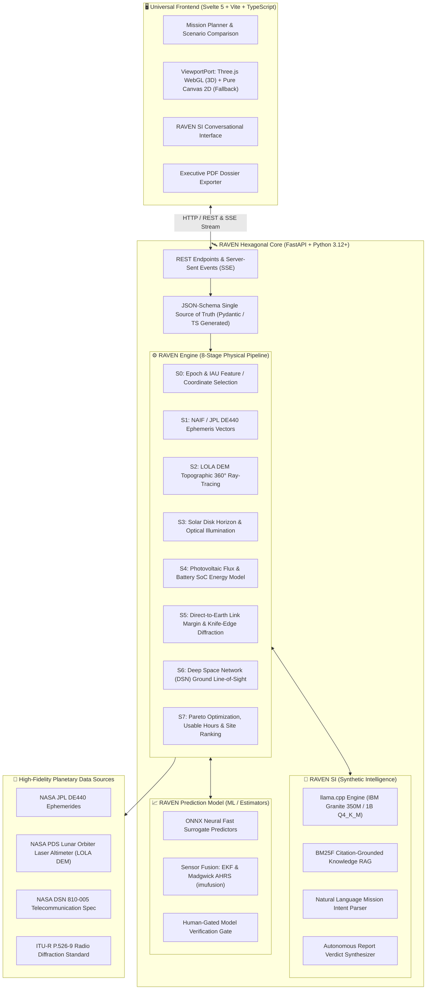
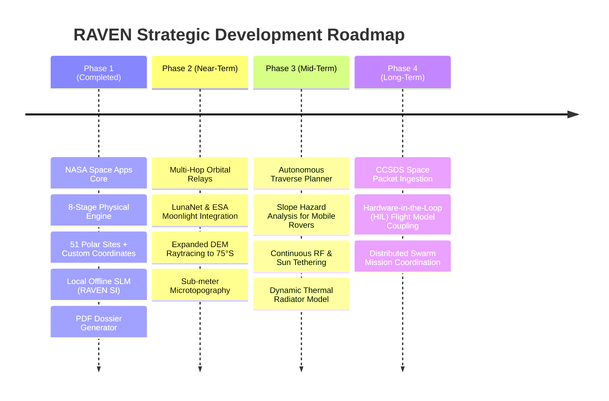

<!-- SPDX-License-Identifier: Apache-2.0 -->
# 🌑 RAVEN — Lunar Landing Site Navigator
### *Rapid Assessment & Visual Exploration of Lunar Navigation*

[](https://www.spaceappschallenge.org/2026/challenges/lunar-landing-site-navigator/)
[](LICENSE)
[](pyproject.toml)
[](frontend/)
[](frontend/src/viewports/)
[](backend/assistant/)
[](e2e/tests/a11y.spec.ts)
[](compose.yaml)

---

## 🌟 Executive Overview & Hackathon Challenge

**RAVEN (Rapid Assessment & Visual Exploration of Lunar Navigation)** is a high-fidelity, intuitive mission planning and scientific decision-support web platform engineered for the **NASA Space Apps Challenge 2026** under the challenge:

> **[Lunar Landing Site Navigator](https://www.spaceappschallenge.org/2026/challenges/lunar-landing-site-navigator/)**  
> *Event:* 2026 NASA Space Apps Challenge · *Difficulty:* Advanced / Intermediate  
> *Subjects:* Human Exploration, Moon, Software, Space Exploration

### 🎯 The Challenge: The South Pole Conundrum

The Moon’s South Pole has emerged as the frontier of human and robotic exploration (NASA Artemis, Commercial Lunar Payload Services — CLPS, ESA, and international initiatives) due to its reservoirs of volatile water ice hidden in **Permanently Shadowed Regions (PSRs)**. However, operating at the lunar south pole presents extreme physical and operational bottlenecks:

1. **Grazing Solar Dynamics:** The solar elevation angle oscillates merely between approximately $-1.5^\circ$ and $+1.5^\circ$ relative to the mean sphere. Crater rims, massifs, and ridges cast colossal, rapidly moving dynamic shadows across potential landing zones. A difference of a few meters in landing location or a few hours in departure date can mean the difference between abundant solar power and catastrophic freezing darkness.
2. **Direct-to-Earth (DTE) Horizon Blockage:** Because the Earth also hovers at a very low elevation ($\sim 1^\circ$ above the horizon), topographical elevations create knife-edge obstacles. Pure line-of-sight geometric visibility is insufficient: electromagnetic waves experience **diffraction, terrain grazing losses, and multipath degradation**.
3. **The Agile Planning Gap:** Current reference tools — such as *NASA QuickMap*, *Moon Trek*, and the *JPL Horizons System* — provide rich technical datasets but are fragmented across separate interfaces with steep learning curves. Mission timelines regularly face delays or contingency recalculations; engineers, planners, and educators need to evaluate alternatives (e.g. *Shackleton Crater* vs. *Malapert Massif* vs. *Haworth*) instantaneously without weeks of manual cross-referencing.

**RAVEN bridges this gap:** An intuitive, unified, publication-grade web application translating complex ephemeris and LOLA topographic data into clear, comparable visualizations, quantitative link margins, and automated mission feasibility verdicts.

---

## 🏛️ System Architecture

RAVEN is designed as a **Modular Hexagonal Monolith (*Ports & Adapters*)**. The architecture enforces zero coupling between the pure domain physics and external infrastructure, ensuring that any component can operate locally, in an isolated container, or as an independent service without altering core logic.



---

## 🔬 Core Architectural Pillars

### 1. 🌑 RAVEN (The Core Platform & Experience)
* **Modular Monolith & Strict Boundary Enforcement:** Guided by `import-linter` with four verified contracts: `backend.core` never imports from API, adapters, ML, or network layers.
* **Dual-Experience Modes:**
  * **Learning Mode (Default):** Plain-language scientific narrative, visual cues, accessible explanations for students, enthusiasts, and educators.
  * **Advanced Mode:** Unfiltered engineering telemetry, link budget breakdowns ($E_b/N_0$, EIRP, $G/T$, free space path loss), raw parameter tables, and CSV/JSON exports.
* **Universal Rendering Engine (`ViewportPort`):** Combines an ultra-smooth **Three.js** 3D WebGL simulator with a **100% Canvas 2D fallback**. The platform runs identically on high-end workstations, smartphones, low-power laptops, and Smart TVs without WebGL support.
* **Hermetic & Accessible:** Built to strictly adhere to **WCAG 2.2 AA**, complete keyboard navigation, D-pad TV mode, and zero non-essential cookies.

### 2. ⚙️ RAVEN Engine (Celestial & Physics Computing Engine)
The mathematical backbone of RAVEN executes an uncompromised 8-stage physical pipeline:
* **Stage S0 — Geometry & Site Setup:** Precise lunar IAU coordinates covering 51 pre-computed polar landing sites, plus dynamic ingestion of arbitrary custom coordinates.
* **Stage S1 — Ephemerides:** Milliradian-accurate positioning of the Sun, Earth, and Moon using NASA NAIF / JPL DE440 kernels, including Earth's libration oscillations.
* **Stage S2 — Topography & Horizons:** 360-degree local horizon azimuth-elevation profiles computed directly from high-resolution NASA Lunar Orbiter Laser Altimeter (**LOLA DEM**) datasets (20 m to 240 m resolution).
* **Stage S3 — Solar Illumination:** Optical ray-tracing accounting for the finite solar angular diameter ($0.5^\circ$), partial disc eclipse by local terrain, and grazing incidence angles.
* **Stage S4 — Power & Energy Balance:** Solar array generation coupled with thermal limitations, operational power baselines, and a continuous battery State-of-Charge (SoC) model.
* **Stage S5 — RF Link Budget & Grazing Diffraction:** Direct-to-Earth telecommunications modeling combining Friis Free Space Path Loss (FSPL) with **ITU-R P.526-9 knife-edge and rounded-ridge obstacle diffraction**. Accounts for antenna gains, receiver figure of merit ($G/T$), and required link margins.
* **Stage S6 — Deep Space Network (DSN) Visibility:** Geometric tracking from Earth ground complexes (Goldstone, Madrid, Canberra) above standard $6^\circ$ elevation operational masks.
* **Stage S7 — Operational Synthesis:** Algorithmic calculation of continuous operational mission windows, uninterrupted useful hours, and multi-criteria site ranking.

### 3. 🧠 RAVEN SI (Synthetic Intelligence & Local Learning Assistant)
* **100% Offline & Zero-Token Cost:** Driven by `llama.cpp` hosting optimized quantized Small Language Models (SLMs) such as **IBM Granite 350M / 1B Q4_K_M** directly on `127.0.0.1`. No external API keys or cloud tokens are required, and no private mission data leaves the host.
* **Lazy Daemon Management:** Automatically started on demand and unloads from system RAM after 5 minutes of inactivity, keeping steady-state memory below 2–3 GB.
* **BM25F Citation-Grounded RAG:** Answers queries by grounding responses strictly in verified repository scientific documentation. Every answer provides traceable references, eliminating LLM hallucinations.
* **Natural Language Intent Extraction:** Allows planners to input mission profiles in natural language (e.g. *"I need a site with at least 100 continuous hours of Earth communication between March and May 2027"*), which RAVEN SI translates into active filter parameters.
* **Automated Executive PDF Verdict:** Automatically drafts a comparative scientific conclusion included at the end of the downloadable mission PDF dossier.

### 4. 📈 RAVEN Prediction Model (ML & Fast Surrogate Layer)
* **Fast Neural Surrogate Estimators:** Employs ONNX Runtime models to approximate heavy topographic horizon ray-tracing, enabling real-time sweeping of entire candidate regions in milliseconds.
* **Sensor Fusion & Attitude Estimation:** Integrates Extended Kalman Filtering (EKF) and Madgwick AHRS estimators (via `imufusion`) to model lander orientation and directional antenna gimbal tracking.
* **Multi-Objective Pareto Frontiers:** Computes optimal trade-offs between conflicting mission requirements (e.g. maximizing solar power vs. maximizing Earth contact time).
* **Safe ML Governance:** Incorporates human-in-the-loop promotion gates; models cannot alter active production logic without Passing explicit validation test suites.

---

## 📊 Feature Comparison Matrix

| Capability | Existing Reference Tools (QuickMap, Horizons) | RAVEN Lunar Navigator |
|---|---|---|
| **Scenario Comparison** | Sequential lookup across multiple tools | Instant side-by-side comparative views & Pareto trade-offs |
| **RF Grazing & Diffraction** | Basic line-of-sight only (binary visible/hidden) | ITU-R P.526-9 knife-edge diffraction & link margin calculation |
| **Integrated Power & Comms** | Disconnected datasets | Fully coupled solar flux, battery SoC, and DTE communication |
| **Offline Deployment** | Cloud/Web only | 100% self-contained local installation with offline LLM |
| **User Interface** | Expert GIS interface | Dual-Mode: Cinematic Apple/NASA-Eyes style + Advanced Engineering |
| **Hardware Accessibility** | Heavy GPU/WebGL requirements | WebGL 3D + 100% pure Canvas 2D fallback for any device |
| **Mission Dossier Output** | Manual screenshots and data collation | Automated vector PDF report with formulas and AI verdict |

---

## 🗺️ Future Roadmap & Scientific Vision



* **Phase 1 — Core Baseline (Current Release):**
  - Complete 8-stage physical pipeline with verified astronomical ephemerides (JPL DE440) and LOLA topography.
  - Interactive Svelte 5 frontend with WebGL/Canvas2D dual renderers.
  - Local offline Synthetic Intelligence (`llama.cpp` + Granite SLM) and automated PDF reporting.
* **Phase 2 — Multi-Hop Relays & Lunar Constellations:**
  - Support for orbital communication relays (**LunaNet** architecture and **ESA Moonlight** constellation) when direct-to-Earth line of sight is obstructed.
  - Sub-meter microtopographic hazard ingestion for landing precision.
* **Phase 3 — Autonomous Rover Traverse Navigation:**
  - Dynamic pathfinding for mobile surface exploration vehicles traversing from sunlit ridges into Permanently Shadowed Regions (PSRs).
  - Multi-variable cost-function optimization combining slope slip risk, solar recharge windows, and RF tethering.
* **Phase 4 — Flight Hardware In-The-Loop (HIL) & Real Telemetry:**
  - Native integration with CCSDS space telecommand and telemetry packet streams.
  - Embedded micro-controller simulation (FreeRTOS / ESP32 HAL) for testing lander guidance, navigation, and control (GNC).

---

## 💰 Economic Viability & Environmental Sustainability

* **Zero Cloud Expenditure ($0/mo SaaS Footprint):** By architecting RAVEN with lightweight, quantized local models (Granite 350M/1B) and an in-process FastAPI engine, the platform requires no recurring cloud API subscriptions, no external token billing, and no costly remote server clusters.
* **Green Computing & Low-Power Hardware:** Designed to run comfortably on standard commercial off-the-shelf (COTS) consumer laptops and edge devices with $\le 4$ CPU cores and $\le 4$ GB of available RAM. Automatic process unloading ensures zero passive energy waste.
* **Mission De-risking for CLPS & Explorers:** Pre-Phase A and Phase A lunar mission design cycles typically cost hundreds of thousands of dollars in engineering person-hours. RAVEN compresses site feasibility trade-offs from weeks into minutes, providing immediate scientific feedback and preventing costly late-stage mission redesigns.

---

## 👥 Project Team & Contacts

*This project was developed for the NASA Space Apps Challenge 2026. For detailed contact information, team credentials, and clickable LinkedIn profiles, visit the in-app **Contacts** view (`/contacts`).*

<div align="center">

| Contributor | Focus Area | Role & Background | Links |
|:---:|:---:|:---:|:---:|
| **Alessio Pompeo** | *Electronics, Telecommunications & Power* | RF Link Budget, Topographic Diffraction, Power & Battery Modeling, System Verification | [](https://linkedin.com) [](https://github.com/AlePompeo) |
| **Team Collaborator** | *Informatics, AI & Space Robotics* | Ephemeris Integration, Backend & Frontend Architecture, 3D Rendering, Machine Learning | [](https://linkedin.com) [](https://github.com) |

</div>

---

## 🚀 Quickstart & Installation

### Option 1: Automated Local Installation (Recommended)
RAVEN includes a self-contained installation script that inspects prerequisites, sets up virtual environments, downloads verified ephemerides and LOLA DEM tiles in parallel, and starts the platform:

```bash
# Clone the repository
git clone https://github.com/AlePompeo/RAVEN.git
cd RAVEN

# Run the automated installer (no root or sudo required)
./install.sh
```

*Options for `./install.sh`:*
* `--yes`: Non-interactive mode (accepts default downloads).
* `--no-browser`: Do not auto-launch default web browser.
* `--port <PORT>`: Bind to a specific HTTP port (default: `8000`).
* `--with-llm`: Download and configure local offline LLM (`llama.cpp` + Granite SLM).

To stop the background server:
```bash
./stop.sh
```

### Option 2: Docker Container
Run the entire platform inside an isolated container:

```bash
docker compose up --build
```
Then navigate to `http://127.0.0.1:8000` in your web browser.

---

## 🧪 Verification & Development

RAVEN enforces strict engineering rigor with comprehensive automated test suites:

```bash
# Backend pytest suite (over 1500 unit and integration tests)
make test

# Type checking and strict linting (Ruff, Mypy, Import-Linter)
make lint

# Frontend component tests (Vitest: 95 test suites, 1050+ tests)
cd frontend && npm test

# Frontend type verification
cd frontend && npm run check

# Production bundle compilation
cd frontend && npm run build
```

---

## 📜 Scientific References & Acknowledgments

* **Planetary Ephemerides:** NASA NAIF / JPL DE440 Solar System Planetary Ephemeris.
* **Topography Data:** NASA Planetary Data System (PDS) Lunar Reconnaissance Orbiter (LRO) Lunar Orbiter Laser Altimeter (LOLA) Science Team.
* **Diffraction Standards:** International Telecommunication Union (ITU-R) Recommendation P.526-9 *"Propagation by diffraction"*.
* **Ground Stations:** NASA Deep Space Network (DSN) Telecommunications Link Design Handbook (810-005).
* **Star Mapping:** NASA Scientific Visualization Studio (SVS) Deep Star Maps 2020.
* **Visual Imagery:** NASA Apollo 8 AS08-14-2383 *"Earthrise"*.

---

<div align="center">
  <sub>Engineered with precision for the NASA Space Apps Challenge 2026. Distributed under the Apache-2.0 License.</sub>
</div>
