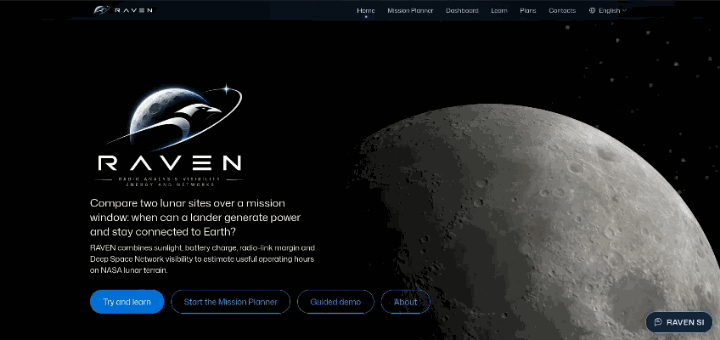
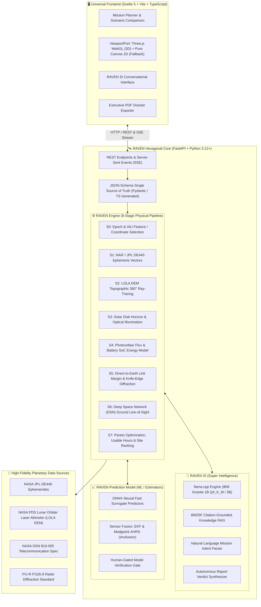
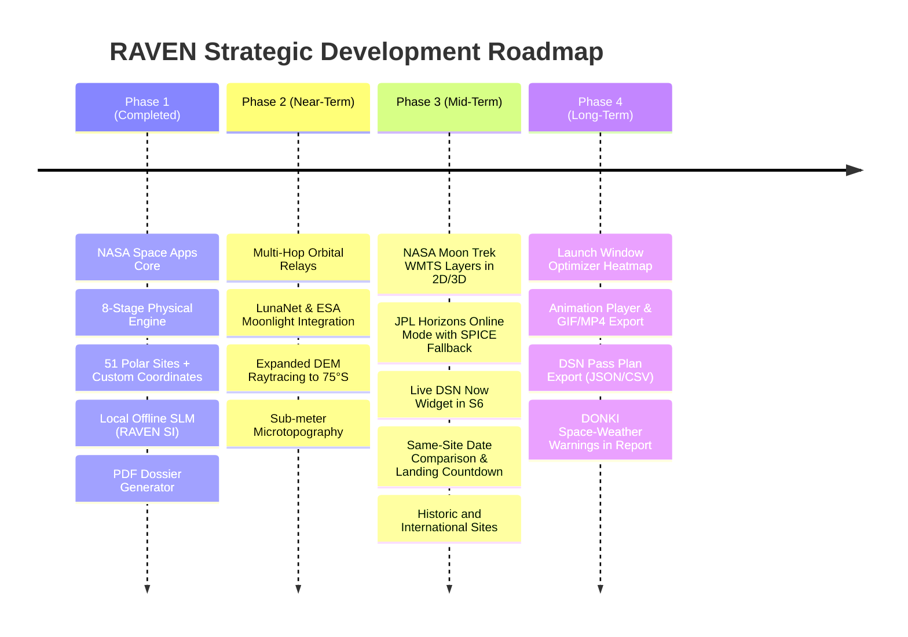

<!-- SPDX-License-Identifier: Apache-2.0 -->
# 🌑 RAVEN — Lunar Landing Site Navigator
### *Radio Analysis, Visibility, Energy and Networks*

[](https://www.spaceappschallenge.org/2026/challenges/lunar-landing-site-navigator/)
[](LICENSE)
[](pyproject.toml)
[](frontend/)
[](frontend/src/viewports/)
[](backend/assistant/)
[](e2e/tests/a11y.spec.ts)
[](compose.yaml)

---

## Video Demo



[Download the original demo video (MP4)](https://raw.githubusercontent.com/AlePompeo/RAVEN/main/frontend/public/raven-demo.mp4)

## PDF Demo Report ECSS
[Download the demo PDF](https://github.com/AlePompeo/RAVEN/blob/main/Mission%20Planner%20_%20RAVEN.pdf)

---

## 🌟 Overview & Hackathon Challenge

**RAVEN (Rapid Assessment & Visual Exploration of Lunar Navigation)** is a mission-planning and scientific decision-support web platform built for the following **NASA Space Apps Challenge 2026** challenge:

> **[Lunar Landing Site Navigator](https://www.spaceappschallenge.org/2026/challenges/lunar-landing-site-navigator/)**  
> *Event:* 2026 NASA Space Apps Challenge · *Difficulty:* Advanced / Intermediate  
> *Subjects:* Human Exploration, Moon, Software, Space Exploration

### 🎯 The Challenge: The Lunar South Pole

The Moon’s south pole is a focus of human and robotic exploration, including NASA Artemis, Commercial Lunar Payload Services (CLPS), ESA, and other international initiatives. Its **Permanently Shadowed Regions (PSRs)** contain reservoirs of water ice, but operating there presents physical and operational challenges:

1. **Grazing solar angles:** The solar elevation angle oscillates between approximately $-1.5^\circ$ and $+1.5^\circ$ relative to the mean sphere. Crater rims, massifs, and ridges cast moving shadows across potential landing zones. A few meters in landing location or a few hours in departure date can make the difference between abundant solar power and freezing darkness.
2. **Direct-to-Earth (DTE) horizon blockage:** Earth also sits at a low elevation ($\sim 1^\circ$ above the horizon), so terrain can create knife-edge obstacles. Geometric line of sight alone is insufficient: electromagnetic waves experience **diffraction, terrain grazing losses, and multipath degradation**.
3. **Planning alternatives:** Reference tools such as *NASA QuickMap*, *Moon Trek*, and the *JPL Horizons System* provide extensive technical datasets, but use separate interfaces with steep learning curves. When a mission is delayed or needs contingency planning, engineers, planners, and educators need a quick way to evaluate alternatives (e.g. *Shackleton Crater* vs. *Malapert Massif* vs. *Haworth*) without weeks of manual cross-referencing.

**RAVEN brings these calculations together** in a web application that turns ephemeris and LOLA topographic data into comparable visualizations, quantitative link margins, and automated mission feasibility verdicts.

---

## 🏛️ System Architecture

RAVEN is designed as a **modular hexagonal monolith (*Ports & Adapters*)**. Its architecture separates the domain physics from external infrastructure, so components can operate locally, in an isolated container, or as independent services without altering the core logic.



---

## 🔬 Core Architectural Pillars

### 1. 🌑 RAVEN (The Core Platform & Experience)
* **Modular Monolith & Boundary Enforcement:** `import-linter` checks four contracts: `backend.core` never imports from API, adapters, ML, or network layers.
* **Dual-Experience Modes:**
  * **Learning Mode (Default):** Plain-language scientific narrative, visual cues, accessible explanations for students, enthusiasts, and educators.
  * **Advanced Mode:** Unfiltered engineering telemetry, link budget breakdowns ($E_b/N_0$, EIRP, $G/T$, free space path loss), raw parameter tables, and CSV/JSON exports.
* **Universal Rendering Engine (`ViewportPort`):** Combines a **Three.js** 3D WebGL simulator with a **Canvas 2D fallback**. The platform runs on high-end workstations, smartphones, low-power laptops, and Smart TVs without WebGL support.
* **Hermetic & Accessible:** Built for **WCAG 2.2 AA**, with keyboard navigation, D-pad TV mode, and no non-essential cookies.

### 2. ⚙️ RAVEN Engine (Celestial & Physics Computing Engine)
RAVEN's physical model runs through eight stages:
* **Stage S0 — Geometry & Site Setup:** Precise lunar IAU coordinates covering 51 pre-computed polar landing sites, plus dynamic ingestion of arbitrary custom coordinates.
* **Stage S1 — Ephemerides:** Milliradian-accurate positioning of the Sun, Earth, and Moon using NASA NAIF / JPL DE440 kernels, including Earth's libration oscillations.
* **Stage S2 — Topography & Horizons:** 360-degree local horizon azimuth-elevation profiles computed directly from high-resolution NASA Lunar Orbiter Laser Altimeter (**LOLA DEM**) datasets (20 m to 240 m resolution).
* **Stage S3 — Solar Illumination:** Optical ray-tracing accounting for the finite solar angular diameter ($0.5^\circ$), partial disc eclipse by local terrain, and grazing incidence angles.
* **Stage S4 — Power & Energy Balance:** Solar array generation coupled with thermal limitations, operational power baselines, and a continuous battery State-of-Charge (SoC) model.
* **Stage S5 — RF Link Budget & Grazing Diffraction:** Direct-to-Earth telecommunications modeling combining Friis Free Space Path Loss (FSPL) with **ITU-R P.526-9 knife-edge and rounded-ridge obstacle diffraction**. Accounts for antenna gains, receiver figure of merit ($G/T$), and required link margins.
* **Stage S6 — Deep Space Network (DSN) Visibility:** Geometric tracking from Earth ground complexes (Goldstone, Madrid, Canberra) above standard $6^\circ$ elevation operational masks.
* **Stage S7 — Operational Synthesis:** Algorithmic calculation of continuous operational mission windows, uninterrupted useful hours, and multi-criteria site ranking.

### 3. 🧠 RAVEN SI (Super Intelligence & Local Learning Assistant)
* **100% Offline & Zero-Token Cost:** Driven by `llama.cpp` hosting optimized quantized Small Language Models (SLMs) such as **IBM Granite 1B Q4_K_M / 3B** directly on `127.0.0.1`. No external API keys or cloud tokens are required, and no private mission data leaves the host.
* **Lazy Daemon Management:** Automatically started on demand and unloads from system RAM after 5 minutes of inactivity, keeping steady-state memory below 4 GB.
* **BM25F Citation-Grounded RAG:** Answers queries by grounding responses strictly in verified repository scientific documentation. Every answer provides traceable references, eliminating LLM hallucinations.
* **Natural Language Intent Extraction:** Allows planners to input mission profiles in natural language (e.g. *"I need a site with at least 100 continuous hours of Earth communication between March and May 2027"*), which RAVEN SI translates into active filter parameters.
* **Automated Executive PDF Verdict:** Automatically drafts a comparative scientific conclusion included at the end of the downloadable mission PDF dossier.

### 4. 📈 RAVEN Prediction Model (ML & Fast Surrogate Layer)
* **Fast Neural Surrogate Estimators:** Employs ONNX Runtime models to approximate heavy topographic horizon ray-tracing, enabling real-time sweeping of entire candidate regions in milliseconds.
* **Sensor Fusion & Attitude Estimation:** Integrates Extended Kalman Filtering (EKF) and Madgwick AHRS estimators (via `imufusion`) to model lander orientation and directional antenna gimbal tracking.
* **Multi-Objective Pareto Frontiers:** Computes optimal trade-offs between conflicting mission requirements (e.g. maximizing solar power vs. maximizing Earth contact time).
* **Safe ML Governance:** Incorporates human-in-the-loop promotion gates; models cannot alter active production logic without Passing explicit validation test suites.


## 🌌 Sites
The catalogue has **51 entries**:

- **27 south-polar features**, five of them tagged as Artemis III candidate features (rims and massifs);
- **24 historical landing sites** (Apollo, Luna, Surveyor, Chang'e, Chandrayaan-3) used as reference points;
- plus **custom coordinates**: terrain is fetched on demand after a size estimate and confirmation.


## 💡 Other features

- **Compare / Mission Planner:** side-by-side A-versus-B scenarios, 7-day default window, N-site ranking in Compare.
- **Site Finder:** automatic search of the polar region with a Gaussian-process surrogate and active learning. The surrogate only chooses where to look; every proposed site is re-evaluated by the full engine, and a Pareto front is shown.
- **RAVEN SI (assistant):** answers grounded in this repository's documentation (BM25F retrieval, with sources). It works with no model at all (extractive mode). Optionally it uses a local `llama.cpp` model on loopback, a local Ollama, or a cloud provider **only if the operator configures one**. Requests to "find the best sites" open the Site Finder (rule-based routing).
- **Report:** printable comparison report with formulas, assumptions and the verdict. Server-side PDF needs the optional `pdf` extra (WeasyPrint and system Pango).
- **Learning and Advanced modes**, English and Italian.
- **Rendering:** Three.js WebGL with a pure Canvas 2D fallback, tested without WebGL.
- **Accessibility:** automated axe-core checks (WCAG 2.2 AA tags) on every page in light and dark themes, plus keyboard navigation tests. Automated checks cover only part of WCAG.

---

## 📊 Feature Comparison Matrix

| Capability | Existing Reference Tools (QuickMap, Horizons) | RAVEN Lunar Navigator |
|---|---|---|
| **Scenario Comparison** | Sequential lookup across multiple tools | Instant side-by-side comparative views & Pareto trade-offs |
| **RF Grazing & Diffraction** | Basic line-of-sight only (binary visible/hidden) | ITU-R P.526-9 knife-edge diffraction & link margin calculation |
| **Integrated Power & Comms** | Disconnected datasets | Fully coupled solar flux, battery SoC, and DTE communication |
| **Offline Deployment** | Cloud/Web only | 100% self-contained local installation with offline LLM |
| **User Interface** | Expert GIS interface | Dual-Mode: Cinematic Apple/NASA-Eyes style + Advanced Engineering |
| **Hardware Accessibility** | Heavy GPU/WebGL requirements | WebGL 3D + 100% pure Canvas 2D fallback for any device |
| **Mission Dossier Output** | Manual screenshots and data collation | Automated vector PDF report with formulas and AI verdict |

---

## 🗺️ Future Roadmap & Scientific Vision



* **Phase 1 — Core Baseline (Current Release):**
  - Complete 8-stage physical pipeline with verified astronomical ephemerides (JPL DE440) and LOLA topography.
  - Interactive Svelte 5 frontend with WebGL/Canvas2D dual renderers.
  - Local offline Super Intelligence (`llama.cpp` + Granite SLM) and automated PDF reporting.
* **Phase 2 — Multi-Hop Relays & Lunar Constellations:**
  - Support for orbital communication relays (**LunaNet** architecture and **ESA Moonlight** constellation) when direct-to-Earth line of sight is obstructed.
  - Sub-meter microtopographic hazard ingestion for landing precision.
- **Phase 3 — NASA Data Integration & Challenge Completion:**
  - **Moon Trek WMTS layers:** optional overlays in the 2D and 3D viewers (LRO Diviner temperature, LROC NAC imagery, PSR maps), streamed as tiles instead of stored locally.
  - **JPL Horizons hybrid mode:** when online, Horizons API ephemerides are used (higher precision, no API key). When offline, RAVEN falls back to the bundled SPICE DE440 kernels. The active source is shown in the UI.
  - **Signal gaps from other spacecraft:** Horizons state vectors of active probes (e.g. LRO, CAPSTONE, Danuri) are used to flag windows where a satellite crosses the Earth line of sight.
  - **Live DSN Now badge in stage S6:** shows which Goldstone/Madrid/Canberra antennas are active (feed from eyes.nasa.gov/dsn).
  - **One-click "compare dates at same site":** e.g. the same site in April vs June vs October, highlighting seasonal sun elevation and libration effects.
  - **Operational countdown widget:** time remaining to local sunset/Earthset from a user-specified landing time.
  - **Exportable UTC window table:** start/end timestamps of each contact and light window.
  - **Historic and international sites:** Apollo 11/17, Chang'e 4/6, Chandrayaan-3, SLIM, CLPS (IM-1, Griffin), for comparison with polar sites.

- **Phase 4 — Mission Planning Platform:**
  - **Launch Window Optimizer:** 6–12 month range for one site, shown as an interactive heatmap (days vs hours of day).
  - **Animation player:** Play/Pause/Step with 1x/10x/100x speed over the 29.5-day cycle, on both 3D and 2D views, with GIF/MP4 or frame-sequence export.
  - **DSN pass plan export:** JSON/CSV with AOS, LOS, solar culmination and sunrise/sunset events.
  - **Mission safety layer:** NASA DONKI (flares, CMEs, SEP storms) as an optional warning in the final PDF report for a given window, flagging radiation risk to electronics and radio attenuation.

---

## 💰 Economic Viability & Environmental Sustainability

* **Zero Cloud Expenditure ($0/mo SaaS Footprint):** By architecting RAVEN with lightweight, quantized local models (Granite 1B / 3B) and an in-process FastAPI engine, the platform requires no recurring cloud API subscriptions, no external token billing, and no costly remote server clusters.
* **Green Computing & Low-Power Hardware:** Designed to run comfortably on standard commercial off-the-shelf (COTS) consumer laptops and edge devices with $\le 4$ CPU cores and $\le 4$ GB of available RAM. Automatic process unloading ensures zero passive energy waste.
* **Mission De-risking for CLPS & Explorers:** Pre-Phase A and Phase A lunar mission design cycles typically cost hundreds of thousands of dollars in engineering person-hours. RAVEN reduces site feasibility trade-offs from weeks to minutes, providing scientific feedback and helping prevent costly late-stage mission redesigns.

---

## 👥 Project Team & Contacts

*This project was developed for the NASA Space Apps Challenge 2026. For contact information, team credentials, and LinkedIn profiles, visit the in-app **Contacts** view (`/contacts`).*

<div align="center">

| Contributor | Focus Area | Role & Background | Links |
|:---:|:---:|:---:|:---:|
| **Chiara Fazi** | *Electronics, Telecommunications & Power* | RF Link Budget, Topographic Diffraction, Power & Battery Modeling, System Verification and Mission Planning | [](https://linkedin.com/in/chiara-fazi) [](https://github.com/Kiraa252) |
| **Alessio Pompeo** | *Embedded Software Engineer, Embodied AI, Space, Satellites, Robotics, Autonomous Systems, GNC and Guidance, System Engineering, V&V * | Ephemeris Integration, Backend & Frontend Architecture, 3D Rendering, Machine Learning* | [](https://linkedin.com/in/alessio-pompeo-it) [](https://github.com/AlePompeo) |

</div>

---

## 🚀 Quickstart & Installation

### Option 1: Automated Local Installation (Recommended)
RAVEN includes an installation script that checks prerequisites, sets up virtual environments, downloads verified ephemerides and LOLA DEM tiles in parallel, and starts the platform:

```bash
# Clone the repository
git clone https://github.com/AlePompeo/RAVEN.git
cd RAVEN

# Run the automated installer (no root or sudo required)
./install.sh

# Optionally install one local IBM Granite model (Linux):
./install.sh --yes --llm-model 1b  # choices: 350m, 1b, 3b
```

*Options for `./install.sh`:*
* `--yes`: Non-interactive mode (accepts default downloads).
* `--no-browser`: Do not auto-launch default web browser.
* `--port <PORT>`: Bind to a specific HTTP port (default: `8000`).
* `--llm-model 350m|1b|3b`: Download the selected IBM Granite model and `llama.cpp` (Linux only).
* `--with-llm`: Install the existing default, Ministral 3B; `--with-llm-small` remains an alias for Granite 1B.
  The model is optional and its answers are not guaranteed to be accurate.
  In a small real test, Granite 350M gave incorrect, uncited explanations; check the sources and prefer a larger model when possible.

To stop the background server:
```bash
./stop.sh
```

### Option 2: Docker Container
Run the entire platform inside an isolated container:

```bash
docker compose up --build
```
Then navigate to `http://127.0.0.1:8000` in your web browser.

---

## 🧪 Verification & Development

RAVEN includes automated tests and checks for development:

```bash
# Backend pytest suite (over 1500 unit and integration tests)
make test

# Type checking and strict linting (Ruff, Mypy, Import-Linter)
make lint

# Frontend component tests (Vitest: 95 test suites, 1050+ tests)
cd frontend && npm test

# Frontend type verification
cd frontend && npm run check

# Production bundle compilation
cd frontend && npm run build
```

---

## 📜 Scientific References & Acknowledgments

### 🪐 Ephemerides & Orbits
- **NASA NAIF / JPL DE440 Solar System Planetary Ephemeris** — [DOI: 10.3847/1538-3881/abd414](https://doi.org/10.3847/1538-3881/abd414) ([NAIF Archive](https://naif.jpl.nasa.gov/))
- **Park et al. (2021)**, *The JPL Planetary and Lunar Ephemerides DE440 and DE441* — [DOI: 10.3847/1538-3881/abd414](https://doi.org/10.3847/1538-3881/abd414)
- **Acton (1996)**, *Ancillary data services of NASA’s Navigation and Ancillary Information Facility* — [DOI: 10.1016/0032-0633(95)00107-7](https://doi.org/10.1016/0032-0633(95)00107-7)
- **NASA/JPL Horizons System** — [Access Portal](https://ssd.jpl.nasa.gov/horizons/)

### 🗺️ Topography & Cartography
- **NASA PDS Lunar Reconnaissance Orbiter (LRO) LOLA Science Team** — [LOLA Data Archive](https://pds-geosciences.wustl.edu/missions/lro/lola.htm)
- **Mazarico et al. (2011)**, *Illumination conditions of the lunar polar regions using LOLA topography* — [NTRS Citation](https://ntrs.nasa.gov/citations/20120010094)
- **NASA PGDA 69**, *Lunar polar illumination products* — [PGDA Portal](https://pgda.gsfc.nasa.gov/products/69)
- **IAU / USGS Gazetteer of Planetary Nomenclature** — [Nomenclature Database](https://planetarynames.wr.usgs.gov/)

### 📡 Telecommunications & Standards
- **International Telecommunication Union (ITU-R) Recommendation P.526-9**, *Propagation by diffraction* — [ITU Rec P.526-9](https://www.itu.int/rec/R-REC-P.526-9-200508-S/en)
- **NASA Deep Space Network (DSN) Telecommunications Link Design Handbook (810-005)** — [DSN Docs Portal](https://deepspace.jpl.nasa.gov/dsndocs/810-005/)
  - *Module 104, Rev. Q* — [PDF Document](https://deepspace.jpl.nasa.gov/dsndocs/810-005/104/104Q.pdf)
  - *Module 301, Rev. P* — [PDF Document](https://deepspace.jpl.nasa.gov/dsndocs/810-005/301/301P.pdf)
- **NASA Small Spacecraft Technology State-of-the-Art (2022)**, *Power Subsystems* — [NASA Report](https://www.nasa.gov/wp-content/uploads/2023/05/3.-soa-power-2022.pdf)

### 🚀 Historical & Spacecraft Reference Reports
- **NASA CR-69102**, *Surveyor Reference Report (1966)* — [NTRS Citation](https://ntrs.nasa.gov/citations/19660005264)
- **Simpson & Tyler**, NASA CR-119032 (1971) — [NTRS Citation](https://ntrs.nasa.gov/citations/19710019588)
- **NASA/TP-2019-220391**, *NASA Lunar Lander Reference Design* — [LPI Document](https://www.lpi.usra.edu/lunar/strategies/NASA-TP-2019-220391.pdf)

### 🌌 Star Mapping & Visual Imagery
- **NASA Scientific Visualization Studio (SVS)**, *Deep Star Maps 2020* — [SVS 4851](https://svs.gsfc.nasa.gov/4851/)
- **NASA Apollo 8 AS08-14-2383**, *"Earthrise"* — [NASA Image Details](https://images.nasa.gov/details/as08-14-2383)

---

<div align="center">
  <sub>Built for the NASA Space Apps Challenge 2026. Distributed under the Apache-2.0 License.</sub>
</div>

---

*Keywords: lunar landing site, NASA Space Apps Challenge, mission planning, radio visibility, energy analysis, communications networks, Moon, space, Python.*
