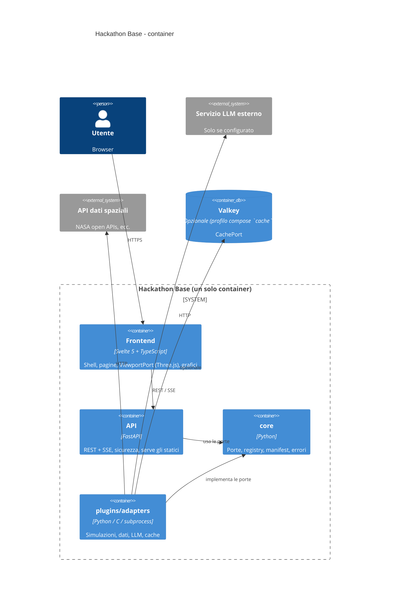
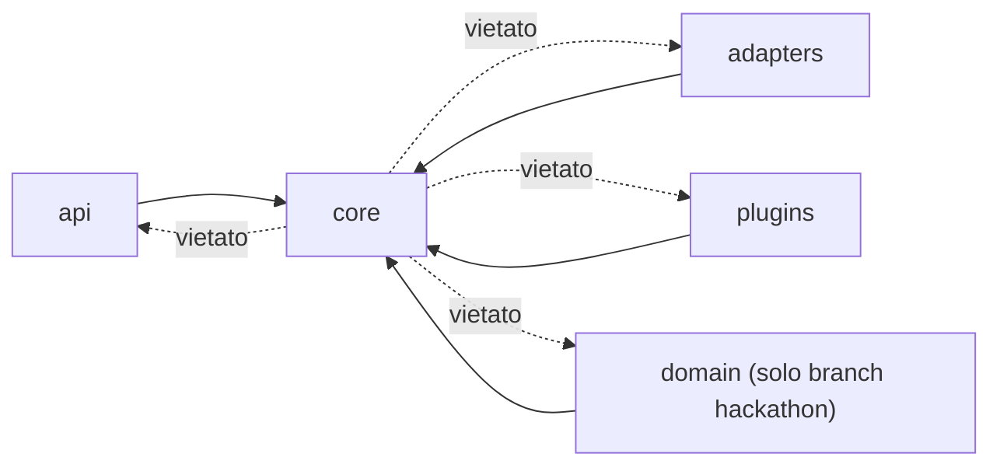

<!-- SPDX-License-Identifier: Apache-2.0 -->
# Architettura

Riferimento: `docs/superpowers/specs/2026-10-12-hackathon-base-design.md` §3.

Monolite modulare esagonale (ports & adapters). Ogni plugin sta dietro una porta che non
assume lo stesso processo: un adapter remoto puo' sostituire quello locale senza toccare il core.

## C4 livello 1-2 (sorgente Mermaid)

## Regola di dipendenza

`backend.core` non importa mai da `backend.adapters`, `backend.api`, `backend.plugins`,
`backend.domain`, ne' da `backend.ml`, `backend.pipeline`, `backend.net`, `backend.bootstrap`, ne' da librerie web, ML, dati o di rete.
Controllato da import-linter in locale (`.importlinter`, comando `lint-imports`, 4 contratti); il job CI che lo esegue e' definito ma la CI di GitHub non e' mai stata eseguita.
La composizione (dependency injection) avviene solo in `backend/bootstrap.py`.

## Tipi di plugin

| Kind | Porta | Stato |
|---|---|---|
| `simulation` | `Simulation` | presente (`example_sim`, `fspl_c`) |
| `data_source` | `DataSource` | presente (`example_data`) |
| `llm` | `LLMProvider` | presente (`example_llm`) |
| `firmware` | `FirmwareSim` | porta e kind nel manifest; NESSUNA implementazione (HAL host in C per il solo controllore servo, `contracts/hal`, non e' un `FirmwareSim`); QEMU/Wokwi/avr8js non implementati |
| `estimator` | `Estimator` | presente (`estimator_imu`, `imufusion` opzionale), endpoint `/api/estimators/{id}/update` |
| `model` | `Predictor` | presente (`predictor_baseline`, `predictor_nn`) |
| `trainer` | `Trainer` | presente (`trainer_baseline`, `trainer_rl`), eseguito in subprocess |
| `environment` | `Environment` | presente (`env_servo`, modello Python del servo; spec §13.6) |
| `telemetry` | `TelemetryStream` | kind accettato ma nessuna porta/implementazione: l'hub SSE e' concreto in `backend/api/routes.py` |

Lo schema `entry` `matlab:` previsto dalla spec §3.3 NON e' supportato (solo `python:` e `exec:`, quest'ultimo ammesso per la sola `simulation`).
Un plugin e' una cartella con `manifest.toml` (`id`, `kind`, `version`, `entry`, `license`);
`entry` e' `python:modulo:Classe` oppure `exec:percorso` relativo alla cartella del plugin.

## Deploy

`Dockerfile` multi-stage (frontend Node 22 (la CI e gli `engines` restano su Node 20.18: da allineare) -> plugin C statico -> Python slim non root); l'API
serve gli statici da `STATIC_DIR` (`backend/api/static.py`, montati dopo le rotte API).
`compose.yaml`: servizio `app`; `valkey` opzionale con profilo `cache` (oggi il bootstrap usa
`MemoryCache`, l'adapter Valkey non e' ancora selezionato).
